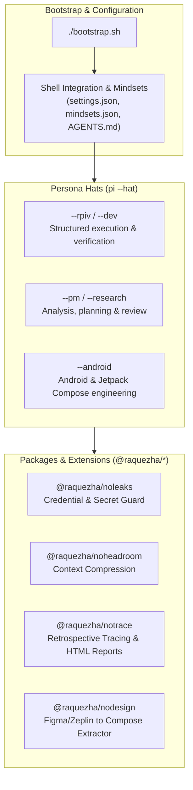

# nothing

AI coding agents frequently leak credentials, bloat token context windows, lose structured session history across runs, and lack deterministic bridges from design specs to mobile code. `nothing` solves this by providing a local-first agentic development environment for Pi that enforces zero-leak privacy guards, compresses prompt context on the fly, logs verifiable session traces, and bridges design tokens directly into Jetpack Compose.

<!-- Demo / Retrospective Report Preview Placeholder -->
<!-- Placeholder: Replace with demo GIF or notrace report screenshot -->
<p align="center">
  
  <br/>
  <em>Placeholder: notrace interactive session report and token savings visualization.</em>
</p>

---

## Architecture

`nothing` bootstraps system dependencies, links custom personas ("hats"), and orchestrates modular packages to deliver reproducible agent workflows on macOS and Linux:



---

## Highlights

### Published `@raquezha/*` Packages
The core tools are published as standalone npm packages for use in any Pi setup:

- **[`@raquezha/noleaks`](./packages/noleaks)**: Intercepts agent prompt payloads and tool calls to block secret, API key, and credential leaks before requests leave your machine.
- **[`@raquezha/notrace`](./packages/notrace)**: Generates deterministic session evidence (`notrace.json`), token optimization metrics, and self-contained interactive HTML reports.
- **[`@raquezha/nodesign`](./packages/nodesign)**: Extracts design tokens, layout specifications, and assets from Figma and Zeplin into clean Jetpack Compose code briefs.
- **[`@raquezha/noheadroom`](./packages/noheadroom)**: Integrates local context compression to reduce token consumption across long-running multi-turn agent sessions.

### Rigorous Automated Testing
- Over 380 automated tests run via `npm test` covering CLI behavior, secret redaction, design extraction parsing, and retrospective reporting.
- CI pipeline validates configurations, shell scripts (`shellcheck`), JSON formats, and multi-platform bootstrap execution across Ubuntu and macOS.

### Automated Changesets Release Pipeline
- Package versioning, changelog generation, and npm registry publishing are fully automated with [Changesets](https://github.com/changesets/changesets) and GitHub Actions.
- Every release includes npm provenance attestations for secure, verifiable artifact distribution.

---

## Getting Started

### 1. Install Full Setup

Clone the repository and run the bootstrap script:

```bash
git clone https://github.com/raquezha/nothing.git
cd nothing
./bootstrap.sh
```

> **Note**: `./bootstrap.sh` sets up global Pi discovery paths to ensure a clean, reproducible starting state. Pass `--no-reset-pi` if you want to retain existing global resources.

### 2. Open a New Terminal

Bootstrap installs shell integration in your user shell configuration. In a new terminal, `pi --tkmx` uses STE in every project.
No per-project setup is required. Existing terminals and running Pi sessions keep their old state until restarted.

---

## Standalone Usage

Individual packages and skills can be used independently without running the full monorepo bootstrap.

### Install published skills
```bash
npx -y skills add raquezha/nothing --full-depth -g -a pi -s '*' -y
```

### Install Pi packages directly
```bash
pi install npm:@raquezha/noleaks
pi install npm:@raquezha/notrace
pi install npm:@raquezha/nodesign
pi install npm:@raquezha/noheadroom
```

---

## Persona Hats & Modifiers

Once shell integration is active, base hats configure personas and skill sets for specific workflows:

### Base Hats
| Command | Mode | Description |
|---|---|---|
| `pi --rpiv` | RPIV Workflow | Formal Frame → Plan → Implement → Verify → Sync lifecycle |
| `pi --research` | Research | Exploratory research workflow (or: `pi --research "topic"`) |
| `pi --pm` | Product / Planning | Problem framing, user stories, and acceptance criteria |
| `pi --dev` | Development | Code implementation and test verification focus |
| `pi --android` | Android Engineering | Jetpack Compose and Android CLI workflow cache |
| `pi --meta` | Monorepo Maintenance | Skill engineering and repository upkeep |
| `pi --nothing` | Minimal | Zero extra tools or context; pristine agent base |

### Behavior Modifiers
Flags can be combined to refine agent output and resource usage:

| Flag | Purpose |
|---|---|
| `--headroom` | Enables local prompt context compression |
| `--caveman` | Terse, token-efficient communication mode (opt-in) |
| `--ste` | Automatically applies concise, complete, unambiguous wording |
| `--rtk` | Terminal output optimization |
| `--cursor` | Local cursor provider extension |
| `--notrace` | Records session retrospective artifacts and reports |
| `--ponytail` | Enforces lazy senior-developer, minimal-diff constraints |
| `--tkmx` | STE + RTK + Cursor + Headroom + antigravity + notrace + Ponytail |

`--tkmx` uses STE instead of Caveman. Use `--caveman` separately when you want sentence fragments.
If both are requested, STE clarity takes precedence. Ponytail still controls implementation scope and concise reporting.

`--ste` loads the local STE extension automatically, using rules from `dotfiles/ste.md`.
No download or skill activation is required. Existing `APPEND_SYSTEM.md` instructions remain intact.
The rules draw from [this STE summary](https://github.com/danyuchn/asd-ste100-skill/blob/master/references/writing-rules.md).
They preserve uncertainty and technical detail, with sentence lengths as guidance rather than hard limits.
This is STE-inspired wording, not verified ASD-STE100 compliance. `--nothing` ignores these modifiers.

---

## Maintenance

- **Run test suite**: `npm test`
- **Verify bootstrap**: `./bootstrap.sh --dry-run`
- **Build packages**: `npm run build --workspaces`
- **Check changeset status**: `npm run changeset:status`

---

## License

This repository is licensed under the [MIT License](./LICENSE). Individual subpackages maintain compatible open-source licenses as noted in their respective directories.
