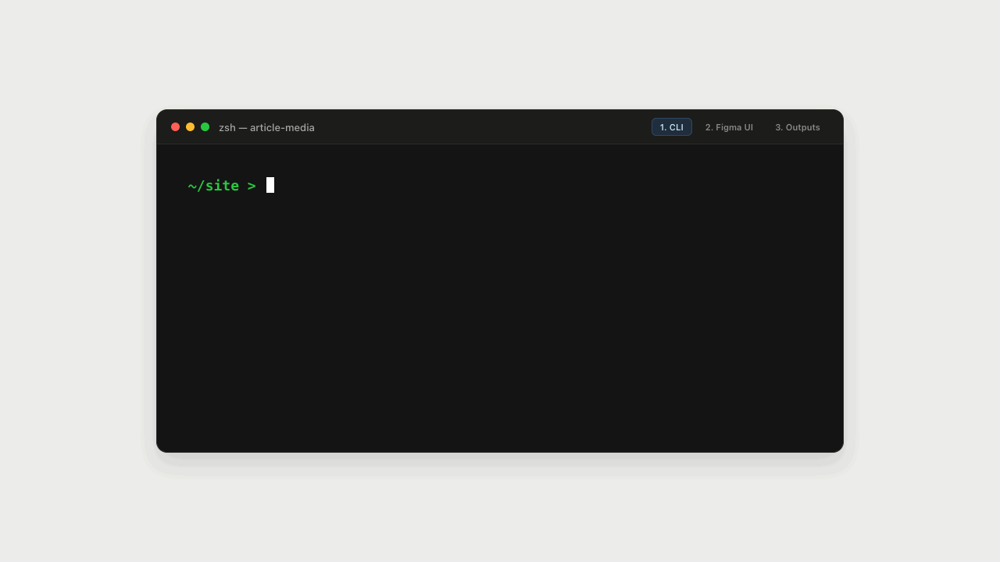
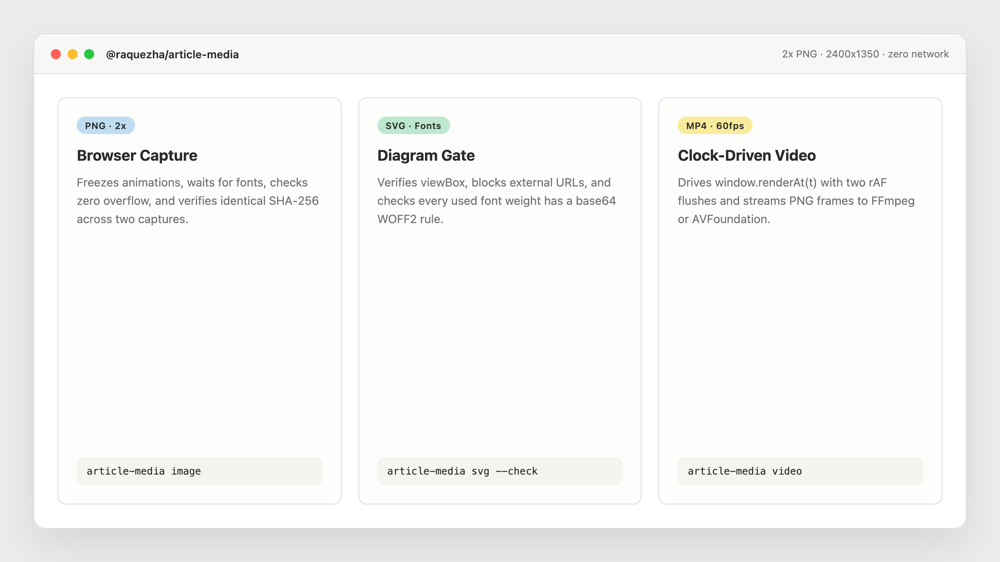
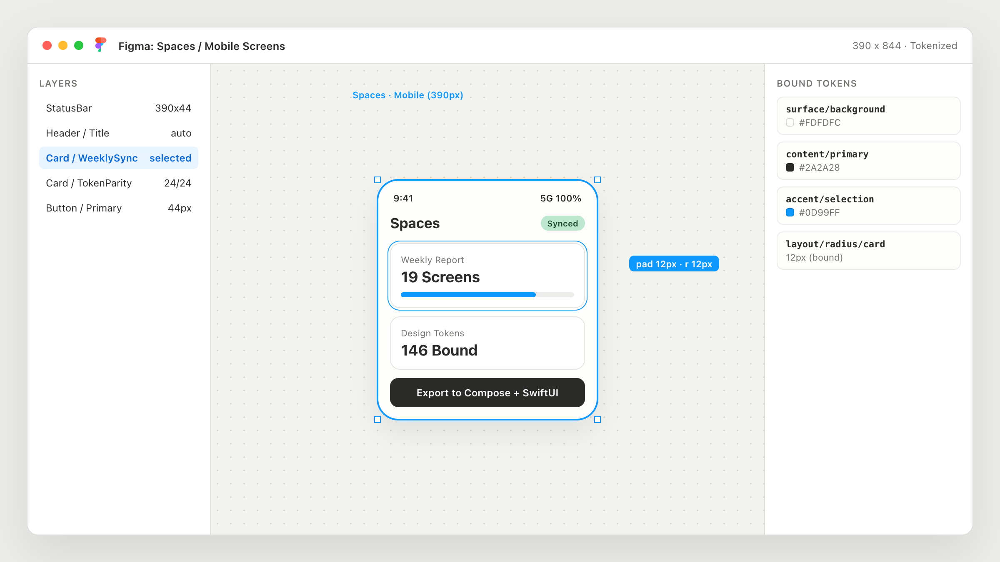

# @raquezha/article-media



> **60fps terminal zoom + typing** rendered deterministically from [examples/terminal-zoom-typing.html](examples/terminal-zoom-typing.html) using `article-media video` ([MP4 version](assets/showcase.mp4)).

Deterministic local media rendering and validation (**PNG**, **SVG**, **MP4**, and **GIF**) for technical articles, changelogs, and documentation.

Built on `playwright-core` and your system Chrome with zero external network requests, zero Playwright-cached FFmpeg binaries, and zero `--no-sandbox` shortcuts.

---

## Why `@raquezha/article-media`?

When developers or AI agents generate article visuals with ad-hoc scripts, the same bugs keep showing up:

- **Silent network and font drift:** Diagrams look fine on macOS, then fall back to system fonts on Linux or Safari because weights weren't embedded.
- **Half-painted animations:** `page.screenshot()` fires before CSS transforms or web fonts settle.
- **Non-repeatable renders:** Wall-clock CSS timers produce different frames every run.
- **Broken exports:** Failed FFmpeg or encoder runs overwrite the previous working file.

`@raquezha/article-media` turns article visuals into deterministic build artifacts:

| Capability | `article-media` | Raw Playwright / FFmpeg | `shot-scraper` |
| :--- | :---: | :---: | :---: |
| 2x PNG with SHA-256 repeatability gate | Yes | DIY | No |
| SVG embedded WOFF2 font + URL audit | Yes | No | No |
| Clock-driven MP4 & GIF (`renderAt(t)`) | Yes | DIY | Real-time only |
| macOS AVFoundation + Linux `libx264` pipe | Yes | DIY | No |
| Atomic output (failed run keeps prior file) | Yes | DIY | No |
| Bundled AI Agent Skill (`SKILL.md`) | Yes | No | No |

---

## Installation & Quick Start

Run directly with `npx`, or install globally:

```bash
# Run without installing
npx @raquezha/article-media --help

# Or install globally
npm install -g @raquezha/article-media
```

### 30-Second Example

1. Create a local HTML scene with a `#capture` container:

```html
<!doctype html>
<html>
  <body style="margin:0">
    <div id="capture" style="width:800px;height:400px;display:grid;place-items:center;background:#fdfdfc;font-family:sans-serif;">
      <h1>Hello, deterministic media</h1>
    </div>
  </body>
</html>
```

2. Capture a 2x retina PNG (`1600x800`) with overflow, font, and SHA-256 repeatability checks:

```bash
npx @raquezha/article-media image --scene scene.html --width 800 --height 400 --output card.png
```

---

## Commands

### 1. Deterministic 2x PNG (`image`)

```bash
article-media image \
  --scene examples/comparison-card.html \
  --width 1200 --height 675 \
  --output out.png
```

- Freezes CSS animations, transitions, and text carets.
- Waits for `document.fonts.ready` and two `requestAnimationFrame` flushes.
- Asserts exact `#capture` bounds and zero scroll overflow (unless `--allow-overflow` is passed).
- Captures twice and compares SHA-256 hashes before writing `--output`.

Optional flags: `--scale <n>` (default `2`), `--selector <css>` (default `#capture`), `--allow-overflow`.

### 2. SVG Portability Check & Preview (`svg`)

```bash
article-media svg \
  --input diagram.svg \
  --check \
  --preview preview.png
```

Checks:
- Explicit `viewBox`, numeric `width`, and numeric `height` on `<svg>`.
- Zero external `http://` or `https://` URLs in `href`, `src`, `url(...)`, or `@import`.
- Every `Caveat` or `Inter` weight referenced via XML attributes or inline `style="..."` has a matching `data:font/woff2;base64,...` `@font-face` rule.
- Optional `--preview <file.png>` renders the SVG inside an isolated `` tag in Chrome so you can inspect the exact output.

### 3. Clock-Driven MP4 & GIF (`video`)

Scenes define a pure `window.renderAt(seconds)` function instead of wall-clock CSS or `requestAnimationFrame` timers:

```html
<script>
  window.renderAt = (seconds) => {
    const progress = Math.min(1, seconds / 4);
    document.getElementById("box").style.transform = `scale(${1 + 0.25 * progress})`;
  };
</script>
```

Render keyframes first, then encode the full `.mp4` or `.gif`:

```bash
# Step 1: Inspect start, middle, and end keyframes (<output>.preview/)
article-media video \
  --scene examples/terminal-zoom-typing.html \
  --duration 6 --fps 60 --width 1280 --height 720 \
  --output demo.mp4 --preview

# Step 2: Encode full 60fps MP4 or 24fps GIF
article-media video \
  --scene examples/terminal-zoom-typing.html \
  --duration 6 --fps 60 --width 1280 --height 720 \
  --output demo.mp4
```

Backwards compatibility: `story-video render ...` forwards directly to `article-media video ...`.

### 4. Batch Manifest (`batch`)

Keep one `media.json` manifest alongside an article and regenerate or verify every asset in one command:

```bash
article-media batch --manifest media.json
```

```json
[
  { "kind": "image", "scene": "card.html", "width": 1200, "height": 675, "output": "out/card.png" },
  { "kind": "svg", "input": "flow.svg", "preview": "out/flow-preview.png" },
  { "kind": "video", "scene": "demo.html", "duration": 5.5, "fps": 60, "width": 1280, "height": 720, "output": "out/demo.mp4" }
]
```

---

## Using With AI Coding Agents

`@raquezha/article-media` ships a bundled [Agent Skill](article-media/SKILL.md) (`"pi": { "skills": ["article-media"] }`) that teaches agents the 5-step workflow plus video and zoom framing rules:

1. Define a one-sentence claim and choose SVG, PNG, or MP4/GIF.
2. Author a self-contained local scene (never fake historical product screenshots).
3. Run `article-media` with deterministic checks.
4. Visually inspect the rendered PNG or `--preview` keyframes before approving (including a peak-zoom frame before full video encodes, readable typing cadence, and measured DOM click targets).
5. Publish and mirror assets without leaving temp files behind.

To make the skill discoverable in Antigravity across all projects, symlink it into your global skills directory:

```bash
mkdir -p ~/.gemini/config/skills
ln -sfn "$(pwd)/article-media" ~/.gemini/config/skills/article-media
```

Or link it per workspace under `.agents/skills/article-media`.

---

## Platform Requirements & Determinism

- **macOS:** Google Chrome installed and Swift / Xcode Command Line Tools (`AVFoundation` for MP4, `ImageIO` for GIF).
- **Linux:** System Chrome or Chromium plus `ffmpeg` (`libx264`) and `ffprobe` (MP4 streams via `image2pipe`, GIF uses `palettegen`/`paletteuse`). Even `--width` and `--height` are required for `yuv420p` H.264.
- **Browser override:** Set `ARTICLE_MEDIA_CHROME` (or `STORY_VIDEO_CHROME`) to point to a custom Chrome/Chromium executable.
- **Cross-OS flags:** Launches Chrome with `--font-render-hinting=none` and `--force-color-profile=srgb` (plus `--disable-dev-shm-usage` on Linux), and locks context to `colorScheme: "light"`, `locale: "en-US"`, `timezoneId: "UTC"`, and `reducedMotion: "reduce"`.

---

## Examples

- [examples/terminal-zoom-typing.html](examples/terminal-zoom-typing.html): smooth 60fps camera zoom and character-sliced typing driven purely by `window.renderAt(seconds)`.
- [examples/comparison-card.html](examples/comparison-card.html): 1200x675 `#capture` template for 2x PNG figures (preview below).
- [examples/mobile-figma-canvas.html](examples/mobile-figma-canvas.html): Figma-style mobile screen canvas with bound token inspector (preview below).
- [examples/non-figma-scene.html](examples/non-figma-scene.html): non-product scene for render and readability checks.





## License

MIT
