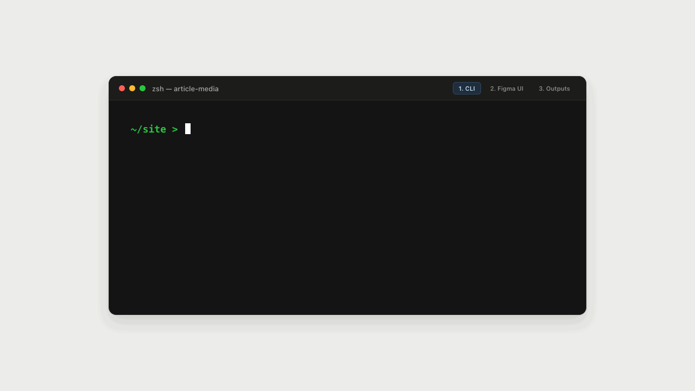
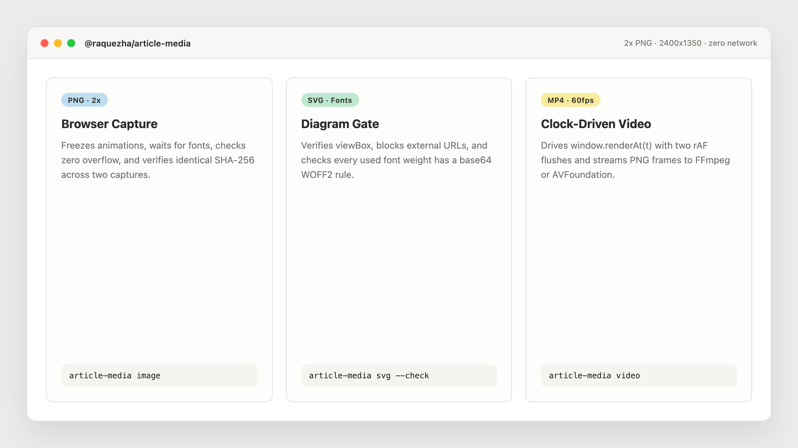
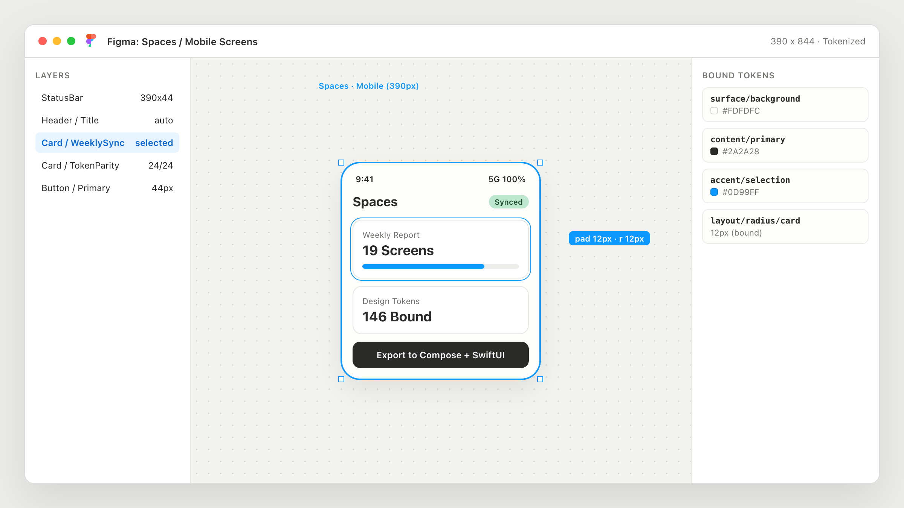

# @raquezha/nocapture



> **60fps terminal zoom + typing** rendered deterministically from [examples/terminal-zoom-typing.html](examples/terminal-zoom-typing.html) using `nocapture video` ([MP4 version](assets/showcase.mp4)).

Deterministic local media rendering and validation (**PNG**, **SVG**, **MP4**, and **GIF**) for writers and developers who want to focus on ideas and let AI agents handle deterministic captures.

Built on `playwright-core` and your system Chrome with zero external network requests, zero Playwright-cached FFmpeg binaries, and zero `--no-sandbox` shortcuts.

`nocapture` is completely style-agnostic: any local HTML, CSS, SVG, Canvas, or WebGL scene works, whether it is a brutalist poster, a 3D/shader experiment, a data visualization, or an editorial card.

Read the backstory on [raquezha.net/writing/no-capture](https://raquezha.net/writing/no-capture) or browse the source on [GitHub](https://github.com/raquezha/nothing/tree/main/packages/nocapture).

---

## Why `@raquezha/nocapture` (and when to use other tools)

Screen recorders like [OpenScreen](https://github.com/getopenscreen/openscreen) and Screen Studio are great when you want to record a real live desktop session, webcam, or audio walkthrough. CLI screenshot tools like Simon Willison's [`shot-scraper`](https://github.com/simonw/shot-scraper) are great for automating screenshots of live URLs in Python.

Try those if they fit your workflow. `nocapture` exists for a different job: **no manual screen recording, no retakes, and no acting out demos**. You (or your AI agent) write a local HTML/SVG scene, and `nocapture` renders deterministic **PNG**, **SVG**, **MP4**, and **GIF** assets straight from code. If one label has a typo, you edit one line and re-run instead of recording the whole take over again.

| Capability | `nocapture` | OpenScreen / Screen Studio | `shot-scraper` |
| :--- | :---: | :---: | :---: |
| Built for live desktop recording | No | Yes | No |
| 2x PNG with SHA-256 repeatability gate | Yes | No | No |
| SVG embedded WOFF2 font + URL audit | Yes | No | No |
| Clock-driven MP4 & GIF (`renderAt(t)`) | Yes | Live timeline | Real-time only |
| macOS AVFoundation + Linux `libx264` pipe | Yes | Desktop app | No |
| Atomic output (failed run keeps prior file) | Yes | No | No |
| Bundled AI Agent Skill (`SKILL.md`) | Yes | No | No |

---

## Installation & Quick Start

Run directly with `npx`, or install globally:

```bash
# Run without installing
npx @raquezha/nocapture --help

# Or install globally
npm install -g @raquezha/nocapture
```

### 30-Second Example

1. Scaffold an HTML template with built-in design tokens and SVG goodies:

```bash
npx @raquezha/nocapture init --template comparison --output scene.html
```

2. Capture a 2x retina PNG (`2400x1350`) with overflow, font, and SHA-256 repeatability checks:

```bash
npx @raquezha/nocapture image --scene scene.html --width 1200 --height 675 --output comparison.png
```

---

## Commands

### 0. Scaffold HTML Templates (`init`)

```bash
# List available templates
nocapture init --list

# Scaffold a specific template
nocapture init --template comparison --output comparison.html
nocapture init --template mobile --output mobile.html
nocapture init --template terminal --output terminal.html
nocapture init --template tutorial --output tutorial.html
```

Available templates:
- `comparison`: Side by side or stacked before vs after cards with badge pills, hand-drawn arrow, and sparkles.
- `mobile`: Realistic smartphone mockup with dynamic island, status bar, home indicator, and feed cards.
- `terminal`: Dark macOS/Linux terminal window with window controls, prompt tokens, and typed command animation.
- `tutorial`: Step by step explainer with camera zoom cues, speech callout bubble, and code stage.

Every template includes the 4-part architectural contract: CSS token variables, fixed canvas layout, hand-drawn vector goodies sprite, and deterministic `window.renderAt(seconds)` timeline scrubber.

### 1. Deterministic 2x PNG (`image`)

```bash
article-media image \
  --scene examples/comparison-card.html \
  --width 1200 --height 675 \
  --output out.png
```

- Freezes CSS animations, transitions, and text carets.
- Waits for `document.fonts.ready` and two `requestAnimationFrame` flushes.
- Asserts exact `#capture` bounds and zero scroll overflow (unless `--allow-overflow` is passed).
- Captures twice and compares SHA-256 hashes before writing `--output`.

Optional flags: `--scale <n>` (default `2`), `--selector <css>` (default `#capture`), `--allow-overflow`.

### 2. SVG Portability Check & Preview (`svg`)

```bash
article-media svg \
  --input diagram.svg \
  --check \
  --preview preview.png
```

Checks:
- Explicit `viewBox`, numeric `width`, and numeric `height` on `<svg>`.
- Zero external `http://` or `https://` URLs in `href`, `src`, `url(...)`, or `@import`.
- Every `Caveat` or `Inter` weight referenced via XML attributes or inline `style="..."` has a matching `data:font/woff2;base64,...` `@font-face` rule.
- Optional `--preview <file.png>` renders the SVG inside an isolated `` tag in Chrome so you can inspect the exact output.

### 3. Clock-Driven MP4 & GIF (`video`)

Scenes define a pure `window.renderAt(seconds)` function instead of wall-clock CSS or `requestAnimationFrame` timers:

```html
<script>
  window.renderAt = (seconds) => {
    const progress = Math.min(1, seconds / 4);
    document.getElementById("box").style.transform = `scale(${1 + 0.25 * progress})`;
  };
</script>
```

Render keyframes first, then encode the full `.mp4` or `.gif`:

```bash
# Step 1: Inspect start, middle, and end keyframes (<output>.preview/)
nocapture video \
  --scene examples/terminal-zoom-typing.html \
  --duration 6 --fps 60 --width 1280 --height 720 \
  --output demo.mp4 --preview

# Step 2: Encode full 60fps MP4 or 24fps GIF
nocapture video \
  --scene examples/terminal-zoom-typing.html \
  --duration 6 --fps 60 --width 1280 --height 720 \
  --output demo.mp4

# Optional: Mux an external audio track (.wav, .m4a, .mp3, .aac) into MP4
nocapture video \
  --scene tutorial.html \
  --duration 6 --fps 60 --width 1280 --height 720 \
  --audio voiceover.m4a \
  --output tutorial.mp4
```

`--audio` strictly muxes an input file you provide (recorded voiceover, TTS track, or UI click Foley) trimmed to `--duration`. `nocapture` never synthesizes audio itself: garbage in, deterministic garbage out.

Backwards compatibility: `story-video render ...` forwards directly to `article-media video ...`.

### 4. Batch Manifest (`batch`)

Keep one `media.json` manifest alongside an article and regenerate or verify every asset in one command:

```bash
article-media batch --manifest media.json
```

```json
[
  { "kind": "image", "scene": "card.html", "width": 1200, "height": 675, "output": "out/card.png" },
  { "kind": "svg", "input": "flow.svg", "preview": "out/flow-preview.png" },
  { "kind": "video", "scene": "demo.html", "duration": 5.5, "fps": 60, "width": 1280, "height": 720, "output": "out/demo.mp4" }
]
```

---

## Using With AI Coding Agents & Team Distribution

`@raquezha/nocapture` ships a bundled [Agent Skill](nocapture/SKILL.md) (`"pi": { "skills": ["nocapture"] }`) that teaches agents the 5-step workflow plus video and zoom framing rules:

1. Define a one-sentence claim and choose SVG, PNG, or MP4/GIF.
2. Author a self-contained local scene (never fake historical product screenshots).
3. Run `nocapture` with deterministic checks.
4. Visually inspect the rendered PNG or `--preview` keyframes before approving (including a peak-zoom frame before full video encodes, readable typing cadence, and measured DOM click targets).
5. Publish and mirror assets without leaving temp files behind.

### Share across your team

- **Claude (Team / Enterprise Admin):** Upload the `nocapture/` skill folder (`SKILL.md` + `references/`) as an organization-wide Skill in Admin Settings so everyone gets it automatically without local setup.
- **ChatGPT (Team / Enterprise):** Create a workspace-shared **Custom GPT** with `nocapture/SKILL.md` as Instructions and `nocapture/references/style-and-review.md` as Knowledge (plus a quickstart note for `npx @raquezha/nocapture`).
- **Coding agents (Pi, Antigravity, Claude Code, Cursor):** Bundle the skill in npm or symlink it globally / per workspace:

```bash
mkdir -p ~/.gemini/config/skills
ln -sfn "$(pwd)/nocapture" ~/.gemini/config/skills/nocapture
```

Or link it per workspace under `.agents/skills/nocapture`.

---

## Platform Requirements & Determinism

- **macOS:** Google Chrome installed and Swift / Xcode Command Line Tools (`AVFoundation` for MP4, `ImageIO` for GIF).
- **Linux:** System Chrome or Chromium plus `ffmpeg` (`libx264`) and `ffprobe` (MP4 streams via `image2pipe`, GIF uses `palettegen`/`paletteuse`). Even `--width` and `--height` are required for `yuv420p` H.264.
- **Browser override:** Set `ARTICLE_MEDIA_CHROME` (or `STORY_VIDEO_CHROME`) to point to a custom Chrome/Chromium executable.
- **Cross-OS flags:** Launches Chrome with `--font-render-hinting=none` and `--force-color-profile=srgb` (plus `--disable-dev-shm-usage` on Linux), and locks context to `colorScheme: "light"`, `locale: "en-US"`, `timezoneId: "UTC"`, and `reducedMotion: "reduce"`.

---

## Examples

- [examples/terminal-zoom-typing.html](examples/terminal-zoom-typing.html): smooth 60fps camera zoom and character-sliced typing driven purely by `window.renderAt(seconds)`.
- [examples/comparison-card.html](examples/comparison-card.html): 1200x675 `#capture` template for 2x PNG figures (preview below).
- [examples/mobile-figma-canvas.html](examples/mobile-figma-canvas.html): Figma-style mobile screen canvas with bound token inspector (preview below).
- [examples/non-figma-scene.html](examples/non-figma-scene.html): non-product scene for render and readability checks.





## License

MIT
